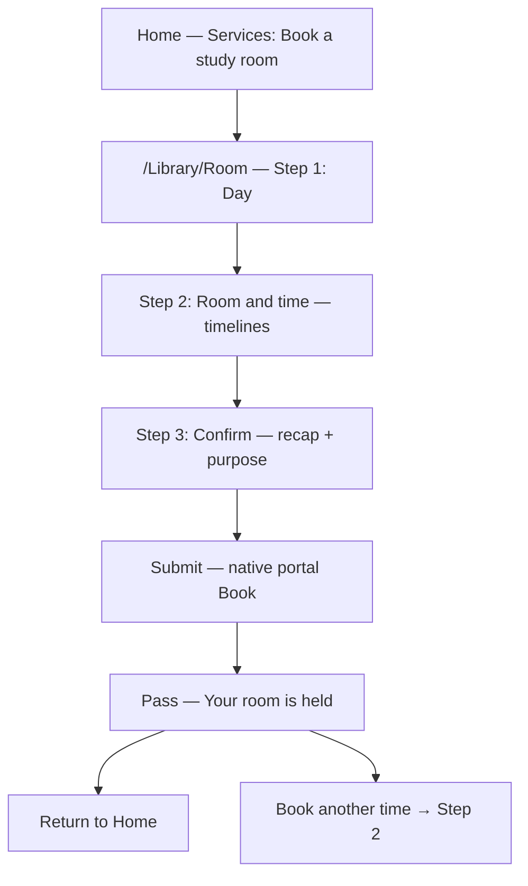
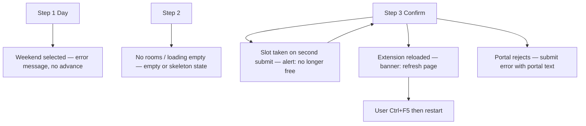

# D4 Part A — Wireflow (structural reference)

Low/medium fidelity for submission: export **grayscale** Figma/PDF screens from this flow (boxes + labels). This document is the **connected flow** with an error path.

## Happy path

## Alternate / error paths

## Screen inventory (for grayscale wireframes)

| ID | Screen | Key elements |
| :---: | :--- | :--- |
| W0 | Home (partial) | Header, Services tile “Book a study room” |
| W1 | Wizard step 1 | Stepper, month calendar, weekday disable |
| W2 | Wizard step 2 | Room rows, horizontal timelines, end-time select |
| W3 | Wizard step 3 | Large recap, purpose field, Confirm Booking |
| W4 | Error on W3 | Red alert (single), example: slot no longer free |
| W5 | Pass | Heading, booking details, Book another time |

## Visual hierarchy (Part A note)

1. **Primary:** Current step in stepper; primary CTA (Next / Confirm Booking).
2. **Secondary:** Recap on confirm; room name on timeline row.
3. **Tertiary:** Purpose optional; helper live region during submit.

**Action:** Export W0–W5 as grayscale PNG/PDF for LMS Part A pack.
