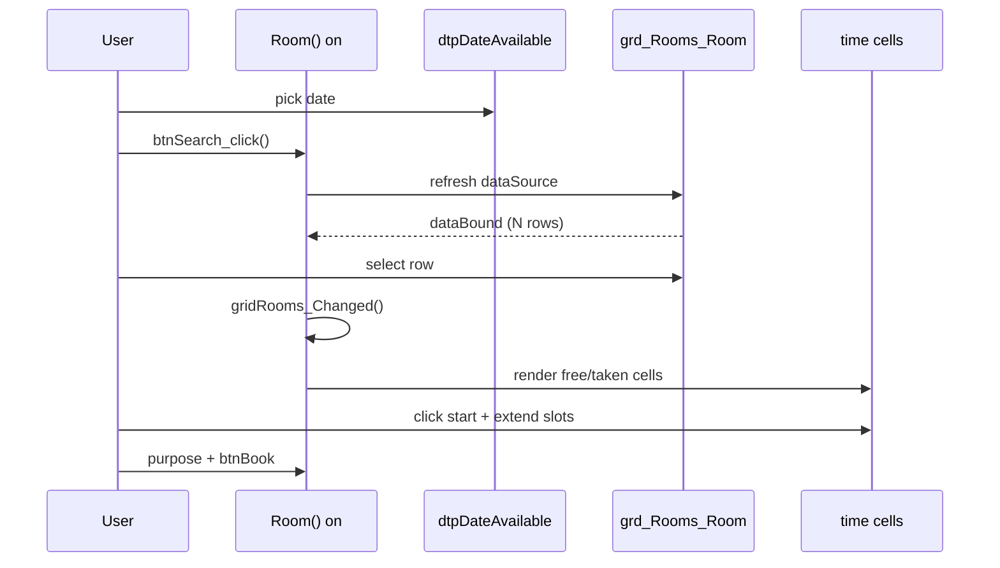

# Native Room Booking Flow — Insignia `Room()` API

**Verified:** 2026-11-03 on `https://nu.insigniails.com/Library/Room` (logged-in)  
**Extension bridge:** `extension/content/bridge/kendo-portal.js` (v0.4.4+)

---

## 1. Page structure (DOM)

| Node | Role |
| :--- | :--- |
| `.flexlayoutcol.roomBooking-content.base-border` | Visible booking shell (breadcrumb + two `.flexlayout` panels) |
| `.navigationbar` | Breadcrumb: My Account / Booking / Room |
| `#divRoomContent.roomBooking-content` | Hidden layout host; jQuery data **`room`** = `Room()` instance |
| `#dtp_DateAvailable_Room` | Date for search (also `room.controls.dtpDateAvailable`) |
| `#btn_Search_Room` | Search — wired to **`room.btnSearch_click()`** |
| `#grd_Rooms_Room` | Kendo grid — `room.controls.gridRooms` |
| `#scheduler` | Month calendar (optional path; extension uses date picker + search) |
| `.roomBookingTimeCell` | 15‑minute cells after a grid row is selected |
| `#sld_TimeFromTo_Room` / `#sld_TimeFromTo2_Room` | Duration via sliders (`room.siler_change`, etc.) |
| `#txt_Purpose_Room` / `#btn_Book_Room` | Purpose + submit |

The extension **cannot** call `window.jQuery` from the content script (Chrome isolated world). v0.4.5+ injects `page-world.js` into the **MAIN** world and uses `postMessage` (`page-bridge.js`).

---

## 2. Sequence the live portal runs

### Step-by-step (extension mirrors this)

1. **Wait** for `window.jQuery`, `#divRoomContent`.data(`room`), and `#grd_Rooms_Room` Kendo grid.
2. **Set date** — `room.controls.dtpDateAvailable.value(date)` (same as DatePicker API).
3. **Search** — `room.btnSearch_click()` — **not** a bare DOM `.click()` on `#btn_Search_Room` (Kendo handler may not run reliably from the extension).
4. **Wait for rows** — grid `dataBound` and/or `dataSource.view().length > 0`.
5. **Read rooms** — map grid rows (`t102Identifier`, `t102Title`, capacity, location).
6. **Per room** — select row in grid, call `room.gridRooms_Changed()`, read `.roomBookingTimeCell` (skip `.disabledTimeCell_Room`).
7. **User slot** — click native free cells; optional slider bridge for 30/45/60 min.
8. **Book** — `#txt_Purpose_Room` + `#btn_Book_Room` (or `room.controls.btnBook` handler); respect `TEST_MODE`.

---

## 3. Why DOM-only search failed

| Approach | Result (observed) |
| :--- | :--- |
| `document.querySelector('#btn_Search_Room').click()` | Grid often stays empty; `dataBound` never fires → extension timeout |
| `room.btnSearch_click()` | Grid loads (e.g. 11 rows) consistently |

---

## 4. Key `Room()` methods (prototype)

Non-exhaustive list from live page:

- `btnSearch_click`, `btnClear_click`, `btnFilterF_click`
- `gridRooms_Changed` — **required after programmatic row select** to refresh time strip
- `scheduler_click`, `dateCell_click`, `scheduler_navigate` — calendar path
- `siler_change`, `showRange`, `changeRange` — slider duration

Access: `jQuery('#divRoomContent').data('room')`.

---

## 5. Extension mapping

| Wizard step | Bridge |
| :--- | :--- |
| Day | `dateBridge.loadDate` → `portalBridge.setAvailableDate` + `portalBridge.search` |
| Room & time | `gridBridge.readRooms` + `roomBridge.loadSlotsForRoom` (+ `notifyRoomSelectionChanged`) |
| Length | `durationBridge.applyDuration` |
| Confirm | `submitBridge.confirmBooking` |

---

## 6. Layout notes (G10 shell)

- Mount wizard **after** `.navigationbar` so breadcrumb stays above the card.
- Hide only wide `.flexlayout` panels immediately (`g10-native-booking-hidden`) to avoid ~1400px horizontal scroll from `#scheduler` / grid layout.
- Host selector: `.flexlayoutcol.roomBooking-content.base-border` (not generic `.roomBooking-content`, which also matches `#divRoomContent`).
