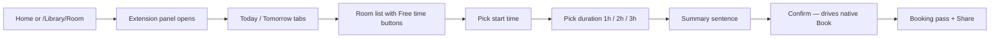

# Prototype Specification — Insignia “Free Rooms First” Browser Extension

**Version:** 0.1 (draft)  
**Team:** G10 MSM Technologies  
**Status:** Specification for D4 implementation — HCI-first, live-portal integration

---

## 1. Purpose

Deliver the D3-selected concept (**Free Rooms First**) as a **Manifest V3 browser extension** that:

1. Presents a simplified, mobile-first booking UI aligned with R1–R5.  
2. **Preserves Insignia backend behaviour** by driving existing Kendo widgets and form posts.  
3. Can be demonstrated live on `nu.insigniails.com` during the D4 checkpoint.

Figma/wireframes remain course artifacts; **the extension is the source of truth for interaction design** unless the team explicitly dual-tracks for LMS submission.

---

## 2. Scope

### In scope (vertical slice)

- Authenticated patron on Islamabad library site.  
- Task: book one study room for a chosen day, start time, and duration (1/2/3 hours per D3).  
- Entry: home tile + direct `/Library/Room`.  
- States: loading, empty (no rooms), error (network/submit fail), success (booking pass).  
- Accessibility: R5 six checkpoints on overlay UI.

### Out of scope (v1)

- Book search, kiosk, assets flows.  
- WhatsApp bot, kiosk hardware, check-in policy (UH-1).  
- Changing server-side availability accuracy (OR1).  
- Firefox/Safari unless time permits (Chrome/Edge first).

---

## 3. User flows

### 3.1 Happy path



### 3.2 Alternate paths

- **No rooms:** Message + “View tomorrow” tab.  
- **Wrong slot taken:** Inline error from portal response + refresh list.  
- **User dismisses overlay:** Chevron to reopen; native UI unchanged underneath.

---

## 4. Information architecture (overlay)

| Level | Pattern | Content |
| :--- | :--- | :--- |
| L0 | Hub-and-spoke | Home tile → booking panel |
| L1 | Sequential wizard (soft) | Day → Room/time → Duration → Confirm |
| L2 | Persistent | “My bookings” link to native My Room Bookings |

Card-sort alignment (team D4 Part A): primary card **“Book a study room”**; secondary **“My bookings”**; tertiary **“Help”**.

---

## 5. UI components (design system minimum)

| Token | Value (initial) |
| :--- | :--- |
| Primary | `#1e3a5f` (align with portal navy) |
| Success | `#0d7a3e` |
| Error | `#b42318` |
| Warning | `#b54708` |
| Type scale | 16px body / 20px section / 24px title |
| Spacing unit | 8px grid |
| Touch target | min 44×44px (exceeds R5 24px minimum) |

**Components:** Primary button, secondary button, tab (Today/Tomorrow), room card, time chip, duration chip, summary banner, booking pass card, toast, skeleton loader.

**Component states (D4 Part B):** default, hover, focus-visible, active, disabled, loading, empty, error, success — apply to time chips and Confirm.

---

## 6. Extension architecture

```
extension/
  manifest.json          # MV3, permissions, content_scripts
  background.js          # optional: badge, install page
  content/
    bootstrap.js         # URL router, feature flags
    overlay/
      shell.html         # injected root (shadow DOM)
      styles.css
      app.js             # UI state machine
    bridge/
      kendo-date.js      # dtp_DateAvailable_Room
      kendo-grid.js      # grd_Rooms_Room
      kendo-slider.js    # set range OR bypass with discrete times
      submit.js          # Purpose field + Book click / form submit
    parsers/
      availability.js    # normalize grid → {roomId, name, slots[]}
  assets/
    icons/
```

### 6.1 manifest.json (sketch)

```json
{
  "manifest_version": 3,
  "name": "FAST Library — Room Booking (G10 Prototype)",
  "version": "0.1.0",
  "description": "HCI prototype overlay for Insignia study room booking.",
  "permissions": ["storage"],
  "host_permissions": ["https://nu.insigniails.com/Library/*"],
  "content_scripts": [{
    "matches": ["https://nu.insigniails.com/Library/*"],
    "js": ["content/bootstrap.js"],
    "css": ["content/overlay/styles.css"],
    "run_at": "document_idle"
  }],
  "action": { "default_title": "Room booking helper" }
}
```

### 6.2 Page routing

| URL pattern | Behaviour |
| :--- | :--- |
| `/Library/Home` | Inject CTA tile “Book a study room” |
| `/Library/Room` | Auto-open overlay; optional hide native `.roomBooking-content` via `aria-hidden` + CSS (keep focus management in overlay) |
| Other `/Library/*` | Floating action button to open panel / go to Room |

### 6.3 Kendo bridge principles

1. **Prefer official widget APIs** (`value()`, `dataSource.read()`, `select()`).  
2. **Never double-submit** — debounce Book; show loading on Confirm.  
3. **Read after write** — after setting date, call Search and wait for grid `dataBound`.  
4. **Fail loud** — if bridge cannot find widget, show “Use standard page” with link to reveal native UI.

### 6.4 Data model (normalized)

```ts
// conceptual
type RoomAvailability = {
  id: string;
  name: string;
  capacity?: number;
  location?: string;
  slots: { start: string; end?: string; status: 'free' | 'taken' }[];
};
```

Populate from grid rows + follow-up time strip parsing (spike required).

### 6.5 Booking pass (R3)

After successful native confirmation:

- Parse confirmation DOM or API response for reference ID.  
- Show pass: room, date, time range, booking ID, Share (Web Share API or copy).  
- Persist last pass in `chrome.storage.session` for demo.

If ID unavailable (OR3), show success with “Check My bookings” and do not fabricate ID.

---

## 7. Non-functional requirements

| NFR | Target |
| :--- | :--- |
| Performance | Panel interactive &lt; 1s after `dataBound` |
| Security | No credentials in extension storage; no external analytics |
| Privacy | No participant data; comply with D1 anonymization |
| Maintainability | `SELECTORS_V1` constant file; changelog when Insignia updates |

---

## 8. AI use disclosure (D4)

Document in submission: which steps used AI (e.g. spec drafting, boilerplate), and what the team manually verified (keyboard audit, live booking test).

---

## 9. Acceptance criteria (implementation done)

- [ ] R1–R5 verification protocols executed and logged (see `VERIFICATION_PROTOCOL.md`).  
- [ ] Instructor can complete happy path on live portal with extension enabled.  
- [ ] At least one handled error state demonstrated.  
- [ ] Overlay passes R5 six checkpoints at 320px width.  
- [ ] Implementation doc updated in repo README or `docs/prototype/IMPLEMENTATION.md`.

---

## 10. Related documents

- `CURRENT_PORTAL_AUDIT.md` — DOM IDs and stack  
- `REQUIREMENTS_AND_TRACEABILITY.md` — R1–R5  
- `HCI_STANDARDS_REFERENCE.md` — heuristics and WCAG  
- D3 PDF — storyboard panels 1–6
